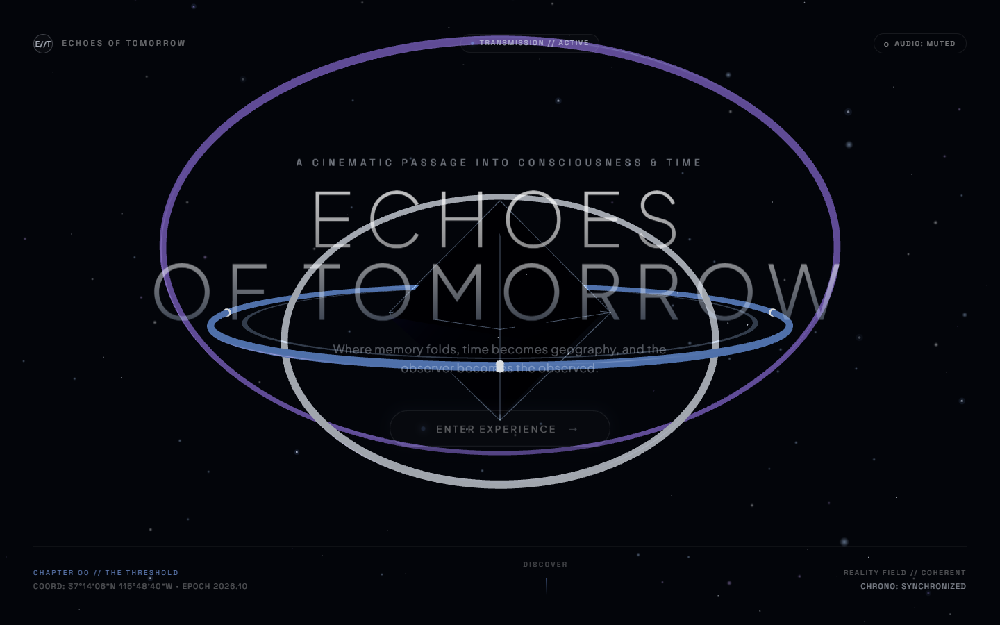

# ECHOES OF TOMORROW

> An existential, cinematic sci-fi digital experience exploring consciousness, time, and the architecture of reality.



---

## Creative Concept

**ECHOES OF TOMORROW** pairs the minimalist restraint of luxury hardware design with the scale and atmosphere of high-end science-fiction cinema. Presented in a deep void palette (#03050A, #101626) with signal blue (#86AFFF), thought violet (#9A82DC), and clarity white (#E5EDF9), the experience invites visitors to navigate three interactive phenomena that probe the boundary between observer and reality.

---

## Key Experience Features

### 1. Monumental 3D Centerpiece & Cinematic Opening
- Suspended multi-axis geometric core featuring nested obsidian polyhedra and concentric chronometric rings.
- Dynamic pointer-driven parallax with damped inertia and clamped angular limits.
- Native Web Audio synthesis generating ethereal sub-bass fundamental drones (48 Hz / 96.4 Hz) and tactile micro-interaction chirps.
- Entrance warp sequence transitioning seamlessly into the central gateway.

### 2. The Observatory Gateway
- Telemetry command deck presenting live spatial parameters and observation nodes.
- Full keyboard integration (`1`, `2`, `3` to select; `Enter` or double-click to initialize).

### 3. Three Interactive Phenomenon Worlds
- **PH-01: THE OBSERVER (Consciousness)**:
  - Nested crystalline octahedron and quantum lattice reflecting and refracting light.
  - Interactive perspective control toggling between *Unified Monolith*, *Bloom Reveal*, and *Quantum Lattice* modes.
- **PH-02: THE LOOP (Time)**:
  - Relativistic orbital time-dilation model along a 3D trefoil epicycle.
  - Interactive bidirectional time-scrub dial ($-5.0\text{s}$ to $+5.0\text{s}$) with throttle-stabilized haptic audio feedback.
  - Speed presets: Rewind ($-2\times$, $-1\times$), Hold ($0\times$), Forward ($+1\times$), and Accelerate ($+3\times$).
  - One-click reset badge to snap back to the current timeline point.
- **PH-03: THE THRESHOLD (Topology)**:
  - Non-Euclidean 4D geometry morphing between a *Tesseract Hyperfold*, *Penrose Singularity*, and an *Expanded Net*.
  - Smooth matrix interpolation between contradictory spatial configurations.

### 4. Accessibility & Performance
- Full `prefers-reduced-motion` compliance: disables spatial camera parallax and autonomous spins while preserving interactive manual controls and state feedback.
- Graceful non-WebGL fallback using layered SVG and CSS gradients if GPU acceleration is unavailable.
- Responsive design tailored across desktop ($1440\text{px}+$), tablet, and mobile ($390\text{px}$) with hardware safe-area inset protection.
- Complete keyboard accessibility:
  - `ESC`: Hierarchical return (Phenomenon $\rightarrow$ Observatory $\rightarrow$ Threshold).
  - `1`, `2`, `3`: Direct jump between observation nodes or active phenomena.
  - `Enter` / `Space`: Skip intro or initialize active gateway.

---

## Technologies Used

- **Framework**: [React 18.3](https://react.dev/)
- **Language**: [TypeScript 5.6](https://www.typescriptlang.org/) (Strict mode)
- **Bundler & Tooling**: [Vite 6](https://vite.dev/)
- **3D Graphics**: [Three.js r186](https://threejs.org/) & [React Three Fiber v8](https://docs.pmnd.rs/react-three-fiber)
- **Audio**: Native Web Audio API (pure browser synthesis without external audio assets)
- **Styling**: Vanilla CSS with modern custom properties, backdrop filters, and CSS Grid/Flexbox (zero UI framework dependencies)

---

## Project Structure

```
EchoesOfTomorrow/
├── index.html                           # App shell, fonts, Open Graph & Twitter metadata
├── package.json                         # Dependencies and build scripts
├── tsconfig.json                        # TypeScript configuration
├── vite.config.ts                       # Chunk splitting & build configuration
├── public/
│   └── preview.png                      # Verified high-resolution experience preview
└── src/
    ├── main.tsx                         # Entry point
    ├── App.tsx                          # Phase orchestration & global hotkeys
    ├── index.css                        # Design tokens, typography & HUD styling
    ├── types.ts                         # Domain models, world IDs, and telemetry
    ├── components/
    │   ├── HeroOpening.tsx              # Cinematic hero intro & warp trigger
    │   ├── MonumentalEclipse.tsx        # Non-WebGL 2D canvas/SVG fallback
    │   ├── ObservatoryView.tsx          # Central phenomenon gateway deck
    │   ├── ParticleField.tsx            # Multi-layer ambient background particles
    │   ├── canvas/
    │   │   ├── CenterpieceScene.tsx     # Centerpiece R3F Canvas & lighting rig
    │   │   ├── CenterpieceStructure.tsx # 3D nested core & anti-aliased rings
    │   │   ├── SparseParticles3D.tsx    # Depth particle cloud with custom sprites
    │   │   ├── WebGLBoundary.tsx        # WebGL error boundary & capability detector
    │   │   └── WorldFallback.tsx        # Per-world 2D geometric fallback
    │   └── worlds/
    │       ├── SegmentedControl.tsx     # Shared tactile pill button group
    │       ├── WorldContainer.tsx       # Standardized phenomenon HUD & navigation
    │       ├── observer/                # PH-01: The Observer scene & shaders
    │       ├── loop/                    # PH-02: The Loop chronometer & epicycles
    │       └── threshold/               # PH-03: The Threshold 4D hyperfold
    ├── hooks/
    │   ├── useMouseParallax.ts          # Zero-rerender damped pointer parallax
    │   └── useReducedMotion.ts          # Media query hook for accessibility
    └── utils/
        ├── pointSprite.ts               # Programmatic circular particle alpha mask
        └── sound.ts                     # Web Audio API procedural synthesizer
```

---

## Getting Started

### Prerequisites

- [Node.js](https://nodejs.org/) v18.0.0 or higher
- [npm](https://www.npmjs.com/) v9.0.0 or higher

### Installation

Clone the repository and install dependencies:

```bash
npm install
```

### Development Server

Launch the Vite local development server:

```bash
npm run dev
```

Open your browser to `http://localhost:5173`.

### Production Build

Create an optimized production bundle:

```bash
npm run build
```

The compiled assets will be output to the `dist/` directory, with vendor chunks split for fast caching and zero warnings.

To preview the production build locally:

```bash
npm run preview
```

---

## Navigation & Controls

| Input | Target | Action |
| :--- | :--- | :--- |
| **Mouse / Touch Move** | Viewport | Drives spatial 3D perspective parallax |
| **`ESC`** | Global | Navigate back one tier (World $\rightarrow$ Observatory $\rightarrow$ Hero) |
| **`1`, `2`, `3`** | Observatory / Worlds | Select observation node or jump between phenomena |
| **`Enter` / `Space`** | Hero Opening | Skip initial entrance / Enter experience |
| **`Enter`** | Observatory | Initialize selected phenomenon world |
| **Click / Tap** | Active Node Card | Double-click or click active node to enter directly |
| **Drag Slider** | The Loop | Scrub chronological timeline delta |
| **Arrow Left / Right** | The Loop Slider | Step time forward / backward via keyboard |
| **Click Timestamp Badge** | The Loop | Reset timeline offset to `0.00s` |

---

## Known Considerations

- **Audio Autoplay Policy**: Modern browsers restrict procedural audio until the visitor performs an initial interaction. The experience begins muted by default; audio can be toggled on at any time using the upper-right **Audio** button.
- **Hardware Acceleration**: Smooth 60 FPS real-time 3D rendering benefits from hardware GPU support. If WebGL is unavailable, the application automatically mounts graceful 2D vector/SVG fallbacks with zero crash risk.
